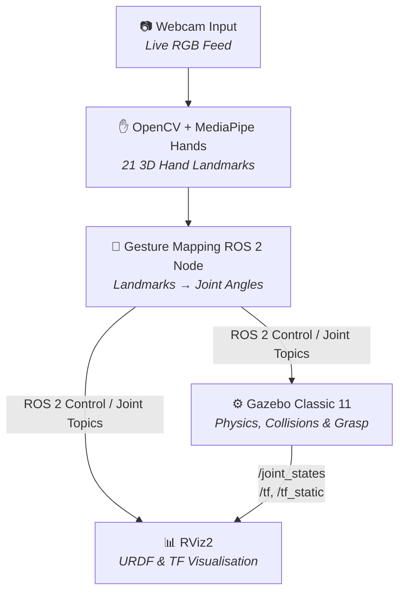
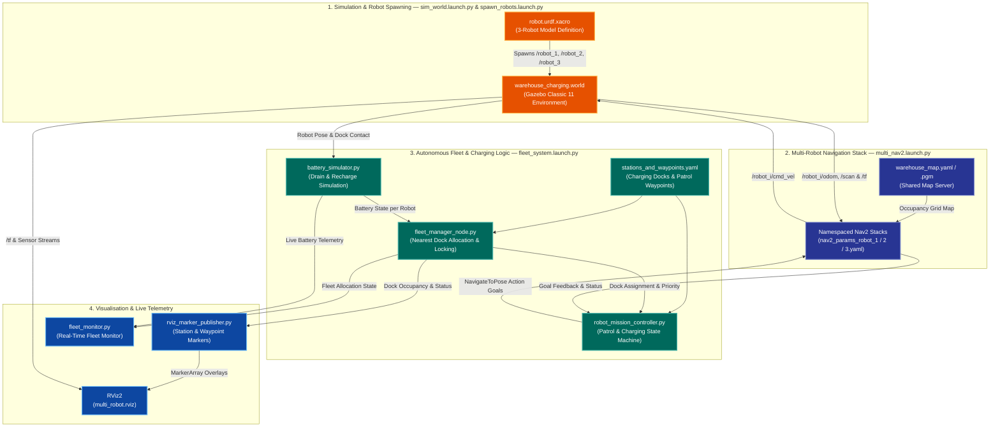

# Hand-Gesture-Controlled 3-DOF Robotic Arm (ROS 2 Humble)


A real-time, vision-based teleoperation system for a **3-DOF robotic arm with a parallel gripper**, developed using **ROS 2 Humble**, **Gazebo Classic (Gazebo 11)**, and **RViz2**. Using a standard webcam with **OpenCV** and **Google MediaPipe**, the system tracks 21 3D hand landmarks in real time and translates human hand movements and finger gestures into smooth joint commands for **pick-and-drop manipulation** in a physics-enabled simulation.

---

## Table of Contents

- [Project Overview](#project-overview)
- [Key Features](#key-features)
- [System Architecture](#system-architecture)
- [Robot Specifications (URDF / Xacro)](#robot-specifications-urdf--xacro)
- [Hand-Gesture Control Mapping](#hand-gesture-control-mapping)
- [Tech Stack](#tech-stack)
- [Workspace Structure](#workspace-structure)
- [Prerequisites](#prerequisites)
- [Installation & Build](#installation--build)
- [Running the Simulation & Teleoperation](#running-the-simulation--teleoperation)
- [Pick-and-Drop Workflow](#pick-and-drop-workflow)
- [Debugging & Verification Commands](#debugging--verification-commands)
- [Demo](#demo)
- [Troubleshooting](#troubleshooting)
- [Future Improvements](#future-improvements)
- [Author](#author)

---

## Project Overview

Traditional robotic arm teleoperation relies on joysticks, teach pendants, or specialised motion-capture rigs. This project replaces dedicated hardware with a low-cost, contactless **computer vision interface**:

- A webcam captures the operator's hand continuously.
- **MediaPipe Hands** extracts real-time landmark coordinates.
- A custom **ROS 2 Python node** maps hand translation and pinch gestures into safe, bounded joint angles and gripper positions.
- **Gazebo Classic** simulates dynamics, gravity, friction, and object collisions during pick-and-drop tasks, while **RViz2** displays live robot kinematics, TF frames, and joint states.

---

## Key Features

- **Contactless Real-Time Teleoperation:** Control all 3 arm joints and the end-effector gripper directly using hand movements in front of a webcam.
- **MediaPipe 21-Landmark Tracking:** Reliable, low-latency hand detection and landmark extraction on standard CPU hardware without requiring a dedicated GPU.
- **3-DOF Manipulator + Gripper:** Custom URDF/Xacro model with articulated base, shoulder, elbow, and gripper links.
- **Full Physics Simulation in Gazebo Classic 11:** Supports realistic object grasping, lifting, moving, and dropping with collision physics.
- **Synchronised RViz2 Visualisation:** Monitor real-time joint transforms (`tf2`), robot model state, and joint feedback alongside Gazebo.
- **Modular ROS 2 Workspace Design:** Clean separation between robot description, controller configurations, launch pipelines, and vision-based control nodes.

---

## System Architecture

## System Architecture
## System Architecture



### Pipeline Overview

| Stage | Component | Responsibility | Output / ROS 2 Topics |
| :--- | :--- | :--- | :--- |
| **1. Capture** | **Webcam Input** | Captures real-time video frames | Live RGB Feed |
| **2. Vision** | **OpenCV + MediaPipe Hands** | Detects hand pose and tracks key points | 21 3D Hand Landmarks |
| **3. Control** | **Gesture Mapping ROS 2 Node** | Translates hand landmarks into target robot joint angles | ROS 2 Control / Joint Topics |
| **4. Simulation** | **Gazebo Classic 11** | Runs physics engine, collision detection, and grasping | `/joint_states`, `/tf`, `/tf_static` |
| **5. Visualisation** | **RViz2** | Renders robot URDF model and real-time transform frames | Live 3D Robot State |
## System Architecture

> Orchestrated end-to-end via **`full_system.launch.py`**, combining Gazebo simulation, multi-robot Nav2 stacks, autonomous charging coordination, and live fleet telemetry.



### Architecture Breakdown

| Layer | Key Files & Nodes | Responsibility |
| :--- | :--- | :--- |
| **Orchestration** | `full_system.launch.py` | Master launch entry point that brings up simulation, robot spawning, multi-Nav2 stacks, fleet nodes, and RViz2 in sequence. |
| **1. Simulation & Spawning** | `sim_world.launch.py`, `spawn_robots.launch.py`, `warehouse_charging.world`, `robot.urdf.xacro` | Launches the Gazebo Classic warehouse world with charging docks and spawns 3 namespaced robots (`/robot_1`, `/robot_2`, `/robot_3`) with independent TF trees and sensor plugins. |
| **2. Multi-Robot Navigation** | `multi_nav2.launch.py`,
```

### Architecture Breakdown

| Layer | Core Components | Responsibility |
| :--- | :--- | :--- |
| **1. Perception** | OpenCV, MediaPipe Hands | Captures live RGB frames and extracts 21 3D hand landmarks in real time. |
| **2. Teleoperation** | Custom ROS 2 Python Node | Normalises landmark coordinates, computes thumb–index pinch state, clamps outputs within safe joint limits, and publishes joint commands. |
| **3. Control & State** | `ros2_control`, `joint_state_broadcaster`, `robot_state_publisher` | Translates commanded targets into controller actions, broadcasts `/joint_states`, and computes forward kinematics (`tf2` transforms) from URDF/Xacro. |
| **4. Simulation & Vis** | Gazebo Classic 11, RViz2 | Executes rigid-body dynamics, gravity, and object grasping in Gazebo while rendering live robot state and TF frames in RViz2. |
```

### Pipeline Stages

1. **Perception Layer:** Captures live video frames via OpenCV and runs MediaPipe Hands to locate key landmarks (wrist, palm centre, thumb tip, and index finger tip).
2. **Control & Mapping Layer:** Normalises hand coordinates to the camera frame, clamps values within safe mechanical joint limits, computes thumb–index pinch distance for gripper actuation, and publishes commands over ROS 2 topics.
3. **Simulation & Actuation Layer:** `ros2_control` / Gazebo Classic plugins apply the commanded joint targets to the simulated 3-DOF arm and gripper.
4. **Feedback & Visualisation Layer:** `robot_state_publisher` broadcasts joint states and TF transforms to RViz2 for real-time monitoring.

---

## Robot Specifications (URDF / Xacro)

| Joint | Type | Primary Role | Control Input |
| :--- | :--- | :--- | :--- |
| **Joint 1 (Base)** | Revolute (Yaw) | Rotates the arm horizontally across the workspace | Hand X-axis movement |
| **Joint 2 (Shoulder)** | Revolute (Pitch) | Lifts and lowers the upper arm link | Hand Y-axis movement |
| **Joint 3 (Elbow)** | Revolute (Pitch) | Extends or retracts the forearm / reach | Hand depth / scale or secondary axis |
| **Gripper Joint(s)** | Prismatic / Revolute | Opens and closes fingers to grasp or release objects | Thumb–index pinch gesture |

> *Update joint names and angle limits (in radians) to match the exact values defined in your URDF/Xacro file.*

---

## Hand-Gesture Control Mapping

| Hand Landmark / Gesture | Metric Used | Robotic Arm Action |
| :--- | :--- | :--- |
| **Move Hand Left / Right** | Palm / Wrist X-coordinate | Rotates Base Joint (CCW / CW) |
| **Move Hand Up / Down** | Palm / Wrist Y-coordinate | Raises / Lowers Shoulder Joint |
| **Move Hand Closer / Farther** | Bounding box / palm scale | Adjusts Elbow Joint extension |
| **Pinch (Thumb Tip `#4` + Index Tip `#8`)** | Euclidean distance below threshold | Closes Gripper (Grasp / Pick object) |
| **Open Palm (Fingers Spread)** | Euclidean distance above threshold | Opens Gripper (Release / Drop object) |

---

## Tech Stack

| Category | Tools & Libraries |
| :--- | :--- |
| **Operating System** | Ubuntu 22.04 LTS (Jammy Jellyfish) |
| **Middleware** | ROS 2 Humble Hawksbill |
| **Physics Simulator** | Gazebo Classic 11 (`gazebo_ros_pkgs`, `gazebo_ros2_control`) |
| **Visualisation** | RViz2, `robot_state_publisher`, `joint_state_publisher` |
| **Robot Description** | URDF, Xacro |
| **Computer Vision** | OpenCV (`cv2`), Google MediaPipe (`mediapipe`) |
| **Programming** | Python 3, NumPy |

---

## Workspace Structure

```text
HAND-GESTURE-CONTROLLED-ROBOTIC-HAND/
├── src/
│   └── <your_package_name>/
│       ├── config/                  # ros2_control YAML & RViz2 (.rviz) configs
│       ├── launch/                  # Gazebo Classic, RViz2, and bringup launch files
│       ├── meshes/                  # STL/DAE visual and collision meshes (if used)
│       ├── urdf/                    # 3-DOF robotic arm + gripper URDF/Xacro files
│       ├── worlds/                  # Custom Gazebo pick-and-drop world files (if used)
│       ├── <your_package_name>/     # Python ROS 2 nodes (MediaPipe gesture teleop)
│       ├── package.xml
│       └── setup.py / CMakeLists.txt
└── README.md
```

---

## Prerequisites

Make sure the following are installed on **Ubuntu 22.04 LTS**:

1. **ROS 2 Humble Desktop:**
   ```bash
   sudo apt update
   sudo apt install ros-humble-desktop
   ```

2. **Gazebo Classic 11 & ROS 2 Control Packages:**
   ```bash
   sudo apt install ros-humble-gazebo-ros-pkgs \
                    ros-humble-ros2-control \
                    ros-humble-ros2-controllers \
                    ros-humble-gazebo-ros2-control \
                    ros-humble-xacro \
                    ros-humble-joint-state-publisher \
                    ros-humble-joint-state-publisher-gui
   ```

3. **Python Dependencies:**
   ```bash
   pip install opencv-python mediapipe numpy
   ```

4. **Hardware Requirement:** Built-in laptop camera or external USB webcam.

---

## Installation & Build

1. **Clone the repository:**
   ```bash
   git clone [https://github.com/aromalajith78/HAND-GESTURE-CONTROLLED-ROBOTIC-HAND.git](https://github.com/aromalajith78/HAND-GESTURE-CONTROLLED-ROBOTIC-HAND.git)
   cd HAND-GESTURE-CONTROLLED-ROBOTIC-HAND
   ```

2. **Source ROS 2 Humble and install package dependencies:**
   ```bash
   source /opt/ros/humble/setup.bash
   rosdep update
   rosdep install --from-paths src --ignore-src -r -y
   ```

3. **Build the workspace with `colcon`:**
   ```bash
   colcon build --symlink-install
   ```

4. **Source the built workspace:**
   ```bash
   source install/setup.bash
   ```

---

## Running the Simulation & Teleoperation

### Terminal 1 — Launch Gazebo Classic & RViz2 Simulation
```bash
source /opt/ros/humble/setup.bash
source install/setup.bash
ros2 launch <your_package_name> <simulation_launch_file>.launch.py
```

### Terminal 2 — Run the MediaPipe Hand-Gesture Control Node
```bash
source /opt/ros/humble/setup.bash
source install/setup.bash
ros2 run <your_package_name> <gesture_control_node>
```

Once the OpenCV webcam window opens, hold one hand clearly in view of the camera to begin controlling the robotic arm in real time.

---

## Pick-and-Drop Workflow

1. **Approach:** Move your hand horizontally and vertically to align the end-effector above the target object in Gazebo.
2. **Position:** Lower the shoulder/elbow joints until the open gripper sits cleanly around the object.
3. **Grasp:** Pinch your thumb and index finger together to close the gripper and secure the object.
4. **Transport:** Raise your hand to lift the object and move laterally toward the drop zone.
5. **Release:** Open your fingers to open the gripper and place the object down.

---

## Debugging & Verification Commands

Use these ROS 2 CLI tools while the simulation is running to inspect system health:

```bash
# Check active ROS 2 nodes
ros2 node list

# Verify published/subscribed topics
ros2 topic list

# Monitor live joint states
ros2 topic echo /joint_states

# Check ros2_control controller status
ros2 control list_controllers

# Visualise the node-to-topic communication graph
rqt_graph
```

---

## Demo

Add a GIF or screenshots showing the webcam MediaPipe tracking overlay alongside Gazebo Classic and RViz2:

```markdown
| Webcam Gesture Tracking | Gazebo Classic & RViz2 Simulation |
| :---: | :---: |
|  |  |
```

---

## Troubleshooting

- **Webcam fails to open:** Check available cameras using `ls /dev/video*` and update the camera index in the Python script (`cv2.VideoCapture(0)` or `1`).
- **Gazebo Classic fails to load or conflicts with Ignition:** Ensure only Gazebo Classic 11 is active in your environment and source `/usr/share/gazebo/setup.sh` if world or model assets fail to spawn.
- **Arm does not move when gesturing:** Confirm that controllers are listed as `active` via `ros2 control list_controllers` and verify that the publisher topic in the gesture node matches the controller's command topic.
- **Jittery arm movement:** Improve ambient lighting, keep a plain background where possible, and keep only a single hand inside the camera frame.

---

## Future Improvements

- **MoveIt 2 Integration:** Add inverse kinematics (IK) and collision-free trajectory planning for Cartesian end-effector control.
- **Signal Smoothing:** Apply an Exponential Moving Average (EMA) or Kalman filter to eliminate micro-jitter from MediaPipe landmarks.
- **Depth Camera Support:** Integrate an Intel RealSense / RGB-D camera for accurate 3D Z-axis depth estimation.
- **Hardware Deployment:** Extend the ROS 2 control interface to a physical 3-DOF servo arm using **micro-ROS** or **Arduino/ESP32**.

---

## Author

**Aromal A**  
Robotics & Automation Engineer  
GitHub: [@aromalajith78](https://github.com/aromalajith78)
